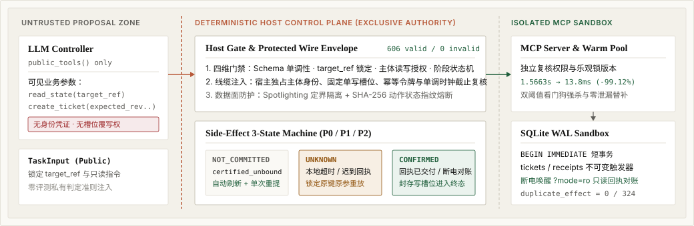

# Harness Reliability Lab


面向具备外部写副作用的智能体工具调用系统，将大语言模型输出隔离为不可信提案，由确定性宿主控制面独占身份凭证、单写槽位、幂等回执与恢复状态机的可靠性实证工程。

**阅读导览**：[在线五幕交互专著](https://i-ivan-x.github.io/harness-reliability-lab/) · [控制面与协议规范](docs/architecture-and-protocol.md) · [实证评估报告](docs/empirical-evaluation.md) · [公开脱敏证据账本](evals/evidence_ledger.json) · [工程纪律契约](AGENTS.md)



---

## 1. 核心工程贡献总览

当工具调用涉及数据库写入、工单派发或权限变更时，网络超时、并发状态失效与外部脏数据注入无法靠提示词工程单独解决。本仓库以确定性控制面为基座，通过冻结配对实验与六组控制面扩展完成端到端闭环验证：

1. **副作用零越界与跨断电自愈**：在 `324` 次配对主基准运行与 `24` 次模拟断电续跑中均保持 **`0` 越权、`0` 重复写**；并发状态版本失效场景下实现 **`100%` 确权恢复**（`0/18 → 18/18`）。
2. **本地与推理双端延迟削峰**：常驻热沙箱池消除 **`99.12%` 子进程冷启动开销**（`1.5663s → 13.8ms`）；揭示并对齐 `56 + 256k` 前缀缓存页边界、统一原生工具输出通道后，单题平均推理耗时降低 **`48.67%`**。
3. **高压上下文防爆与纵深防御**：在 `>24.5 KB` 多分片状态与 `12` 份领域规程高压场景下，落盘切片读取与只读子智能体架构将主上下文峰值输入词元压降 **`92.53%`**，并阻断间接提示词注入与死循环空转（环路词元减少 `61.73%`）。
4. **防作弊过程审计与后训练飞轮**：步级因果过程评分器 **`100%` 拦截**纯结果评分器漏判的 `16/20` 伪满分作弊轨迹，并在 `16` 项负向脱敏红线下安全导出监督微调、同前缀偏好对与过程奖励样本。

---

## 2. 冻结配对主基准（`324` Runs）

主基准在 `18` 道冻结任务（`6` 道并发版本失效题 + `12` 道常规/超时/权限控制题）上，对两款模型端点分别测试三档递进恢复策略——零重试单次执行基线（`P0`）、未知提交态下的同槽位原参数幂等重放（`P1`），以及服务端确权该写槽位尚未产生任何提交或绑定（`certified_unbound=true`）后的宿主自动刷新与单次修正重提（`P2`）。全批 `324` 个槽位、`54` 个配对区组均单次执行封存，外部 API 异常为 `0`，`810` 次线缆请求帧全部闭合对账：

| 模型与策略档位 | 正确处置 `/54` | 并发版本失效 `/18` | 控制组 `/36` | 目标完成 `/36` | 失效组 / 控制组 `pass^3` | 每净增恢复墙钟代价 |
| :--- | ---: | ---: | ---: | ---: | :---: | ---: |
| `A-P0` (`deepseek-flash` · 零重试) | `24` (`44.4%`) | `0` | `24` | `6` | `0/6` · `8/12` | — |
| `A-P1` (`deepseek-flash` · 同键幂等重放) | `36` (`66.7%`) | `0` | `36` | `18` | `0/6` · `12/12` | 基线对照 |
| `A-P2` (`deepseek-flash` · 确权刷新重提) | `54` (`100.0%`) | `18` | `36` | `36` | `6/6` · `12/12` | `+2.371s` |
| `B-P0` (`doubao-seed-2-1-lite-260915` · 零重试) | `24` (`44.4%`) | `0` | `24` | `6` | `0/6` · `8/12` | — |
| `B-P1` (`doubao-seed-2-1-lite-260915` · 同键幂等重放) | `36` (`66.7%`) | `0` | `36` | `18` | `0/6` · `12/12` | 基线对照 |
| `B-P2` (`doubao-seed-2-1-lite-260915` · 确权刷新重提) | `53` (`98.1%`) | `18` | `35` | `36` | `6/6` · `11/12` | `+6.405s` |

---

## 3. 控制面扩展实证汇总

针对主基准暴露的本地子进程冷启动、跨模型推理延迟差（占两模型总墙钟差值的 `99.99%`）以及单引号字典词法退化，在不改动任何冻结源码与主基准产物的条件下完成六组扩展实验：

| 演进方向与模块代号 | 核心控制面机制 | 实测规模 | 关键定量结果 |
| :--- | :--- | :---: | :--- |
| 常驻热沙箱池 (`M1A`) | JSON-RPC 会话多路复用 + 管道挂死双阈值看门狗强杀替补 | `36` 对配对运行 | 启动中位数 `1.5663s → 13.8ms`（`-99.12%`），决策 `100%` 一致 |
| 断电无状态唤醒 (`M1B`) | `?mode=ro` 只读挂载 SQLite 回执表与截断日志四象限因果对账 | `24` 次断电续跑 | `24/24` 终态签名一致，`6/6` 已提交回执直恢复，`0` 重复写 |
| 缓存页对齐与思考调控 (`M2A+M3`) | 揭示 `56 + 256k` 缓存页规律；动静分离 + 强制工具通道 + `p_rec < 45%` 盈亏律 | `64` 次运行 (`244` 请求) | 未见新题首轮缓存命中率 `75.01%` / `96.66%`；推理耗时 `-48.67%`，`0` 格式错误 |
| 上下文虚拟化与只读子智能体 (`M2B+M4`) | `>4 KB` 溢出落盘分页读取 + 按需规程加载 + `can_write=False` 巡检子智能体 | `18` 次高压运行 | 全量内联 `0/6` 阻断 → 虚拟化子智能体 `6/6` 完成，主峰值词元 `-92.53%`，写探测 `6/6` 拒绝 |
| 数据面定界与环路熔断 (`M5`) | `state.facts` 双层不可信定界符 + SHA-256 动作状态指纹熔断器 | `16` 次红队运行 | 越权写恒为 `0`，`4/4` 注入零诱导，死循环输入词元 `-61.73%` |
| 三级过程审计与后训练导出 (`M6`) | 区分洁净轨迹、有效卫生瑕疵与五类作弊；导出掩码微调与同前缀偏好对 | `60` 轨迹 + `38` 导出样本 | 作弊拦截精确率/召回率双 `1.0`（纯结果评分漏判 `16/20`），折扣回报 `1.792 > 1.741 > -0.606` |

---

## 4. 仓库分层目录与免密钥 5 秒核验

| 目录或路径 | 职责边界与冻结纪律 |
| :--- | :--- |
| `src/harness_lab/` | 零字节冻结运行时内核：控制面状态机、四维门禁、MCP 单协程会话管理、单调时钟与 SQLite 不可变回执表 |
| `specs/` · `tasks/frozen/` | 零字节冻结契约规格（`replication-v1.json`、`replication-v2.json`）与 `18` 道确定性沙箱诊断题集 |
| `evals/` | 独立协议/门禁/结果审计器、延迟与探针诊断、后训练安全导出、扩展实验套件及离线总审计入口 `evals/verify_all/` |
| `docs/` | 两份正交深度报告：[控制面与协议规范](docs/architecture-and-protocol.md) 与 [实证评估报告](docs/empirical-evaluation.md) |
| `site/` | 五幕交互专著及自动生成的静态阅读页。离线阅读可双击 `site/index.html`。 |
| `tests/` | 全离线确定性回归测试套件（覆盖跨层依赖边界、线缆超时、看门狗自愈、断电对账、静态站编译同步与脱敏门禁） |

所有离线核验均在零外部 API 调用、零 `.env` 密钥与锁定依赖下运行：

```bash
uv sync --frozen --group dev
uv run --frozen --no-env-file harness-lab doctor
uv run --frozen --no-env-file python -m evals.verify_all --ci
uv run --frozen --no-env-file pytest -c pyproject.toml
```

当工作区包含完整原始 `artifacts/` 目录时，可执行全量重评分、SHA-256 树对账，并确定性再生成公开账本与全部 `site/*.html` 配套静态页：

```bash
uv run --frozen --no-env-file python -m evals.verify_all --export-ledger
uv run --frozen --no-env-file harness-lab replay --trace artifacts/replication-v2-2026-11-17/blocks/b01-acc-05-r1-B/P2/trace.jsonl
```
